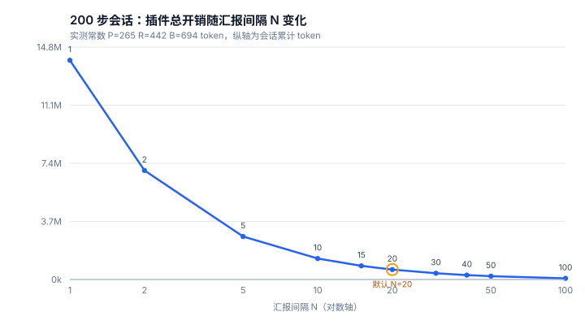
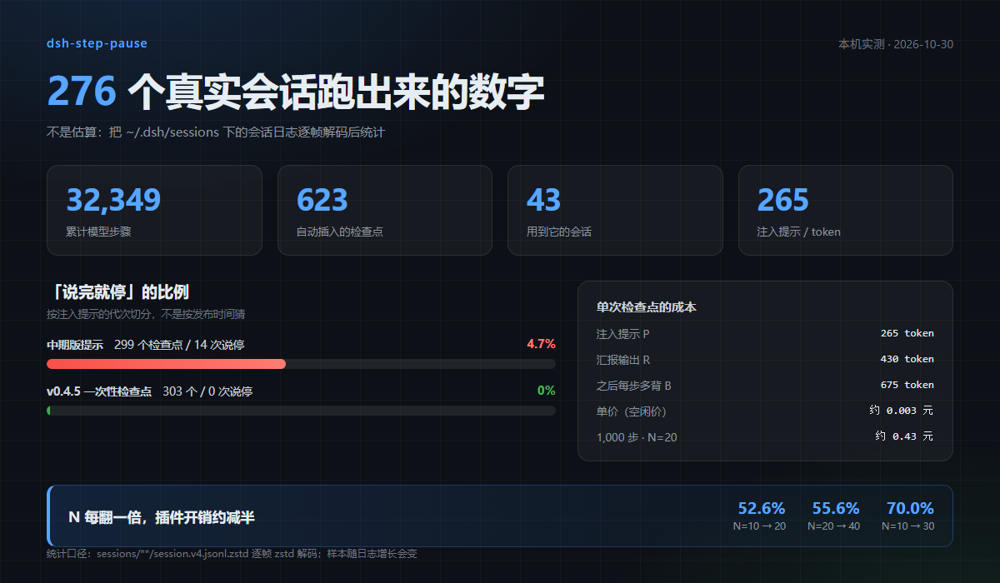

# dsh-step-pause

> **每 N 步自动停下来汇报一次进度，说完立刻继续。**
> 不占额外回合、不等你回复、不生成文档 —— 就几行对话正文。

[](https://github.com/cxv117793-blip/dsh-step-pause/releases/latest)
[](https://github.com/cxv117793-blip/dsh-step-pause#兼容性)
[](https://github.com/cxv117793-blip/dsh-step-pause#兼容性)
[](https://github.com/cxv117793-blip/dsh-step-pause#开发)
[](LICENSE)

**中文** ｜ [English summary](#english-summary)

长任务跑到第 30、40 步，你往往不知道它在干什么、卡在哪、还要多久。这个插件按固定节奏
把进度**主动说出来**：正在做什么 / 已完成什么 / 接下来做什么 / 卡点 —— 然后接着干。

它已经在本机的 **276 个真实会话、32,349 个模型步骤**里跑了 **623 次检查点**，
「说完就停」的比例从 **4.7%（v0.4.5 之前的系列式提示）降到 0%（v0.4.5 起的一次性检查点）**，
每次检查点约 **0.3 分钱**（含它之后被反复重读的那部分）。
数据来自会话日志逐帧解码，不是估算 —— 附录见 [实测数据](#实测数据本机跑出来的数字)。

```text
进度小结（第 40 步）：
1. 正在做什么：给设置页补上表格导出的失败重试
2. 已完成什么：定位到 retry 没有重置 backoff；改了 3 处；单测补了 2 组
3. 接下来做什么：跑全量测试，然后提交
4. 卡点：无
```


---

## 30 秒看懂

| 你可能在想 | 实际情况 |
|---|---|
| 会不会多花一次模型调用？ | **不会**。消息追加进**本步**的输入批次，汇报和后续动作在同一次响应里完成，不产生额外回合 |
| 会不会停下来等我点确认？ | **不会**。没有任何 `wait` / `ask` 语义，写完自己接着干 |
| 那它会不会"说完就停"？ | 会有概率：没有工具调用的回复会让这一轮结束。按提示词代次实测：**中期版 4.7%**（299 次里 14 次），**v0.4.5 起的一次性检查点 0%**（303 次里 0 次）。另有「回合关闭前自动拉回」兜底，见 [docs/auto-resume.md](docs/auto-resume.md) |
| 会不会打断正在跑的工具？ | **也不会**，但代价是：一次 3 分钟的 `npm test` 期间它什么都说不了（它挂在两次思考之间的边界上） |
| 会不会污染子任务？ | **默认不会**。`mainAgentOnly: true` 时子智能体一次都不注入（v0.3.0 起 header 读不到也**不注入**） |
| 会不会把对话刷爆？ | 有 `maxReportsPerTurn` 兜底；提示词原文默认**隐藏**，对话里只留你写的进度小结 |
| 提示词会不会覆盖我的格式要求？ | **有这个风险**，见[高风险第 2 条](#2-注入的是真正的-user-消息会永久写进会话历史并影响后续上下文)。缓解办法是把 N 调大、在提示词里显式声明"原任务约束仍然有效" |

**默认节奏是每 20 步**，可在两个地方改，保存即生效、不用重启：
侧边栏左下角头像 →「设置」→ 步数暂停，或 设置 → 插件 → 分步暂停 → `›` → 配置。

## 安装

桌面版**不要**用 `dsh plugin --profile desktop` 直接改 profile —— 它由应用内的插件管理器独占。二选一：

1. **应用内安装**：`设置 → 插件 → 添加插件 → 从本地目录`，选这个仓库的根目录；
2. **命令行**（只对非 desktop 的 profile）：

```bash
dsh plugin --profile <你的profile> add file:<这个仓库的绝对路径>
```

也可以直接用 [Releases](https://github.com/cxv117793-blip/dsh-step-pause/releases/latest) 里的 `.tgz`：

```bash
# 固定别名，永远指向最新版（市场与脚本都用这条）
https://github.com/cxv117793-blip/dsh-step-pause/releases/latest/download/dsh-step-pause.tgz

# 带版本号（钉死到某个版本时用）
https://github.com/cxv117793-blip/dsh-step-pause/releases/download/v0.4.9/dsh-step-pause-0.4.9.tgz
```

> 桌面版的安装框支持「npm 包、Git 仓库和本地目录」，把上面这条 URL 粘进去即可。

装完按 `文件 → 退出` **完全退出应用**再启动（不是刷新页面）。

---

## 宣传片（52 秒 · 含配音与讲解员）

[](docs/promo/dsh-step-pause-promo-final.mp4)

点封面看 52 秒 1080p 宣传片：痛点 → 原理 → 真机效果 → 配置页 → 能力清单 → 结尾。
全片配中文旁白与同步字幕，左下角的「大肥鱼」讲解员会随音量点头、起浮、亮光晕。
分镜总览见 [contact-sheet.png](docs/promo/contact-sheet.png)。

---

## 它解决什么问题

- 每满 N 步，往**当前步骤的输入批次**里追加一条消息，要求模型先汇报再继续；
- 因为它属于「本步输入」而不是新任务，所以**不产生额外回合**，汇报和后续动作在同一次响应里完成；
- 不会把任务挂成「等待用户确认」，也不会打断正在跑的工具调用（边界本来就是两次思考之间）。

## 配置

两个入口，同一份表单（任何一处保存，另一处立刻同步）：

- **侧边栏左下角头像 →「设置」→ 步数暂停**（`settings.section`，排在账号、模型这些官方段之后）
- **设置 → 插件 → 分步暂停 → › → 配置**（插件页那一行）

八个字段都带说明与草稿态：

| 键 | 默认 | 说明 |
|---|---|---|
| `enabled` | `true` | 总开关。关掉后插件仍然加载，但不再汇报 |
| `everyNSteps` | `20` | 每多少步汇报一次（按轮次内的步骤计，实际生效 2–500；写 1 会被夹成 2）。**默认 20 的由来见下文「默认值是怎么定的」** |
| `maxReportsPerTurn` | `0` | 每轮最多汇报几次；`0` 表示不限制（兜底防失控轮次刷屏，上限 1000） |
| `prompt` | 见下 | 注入的提示词，支持 `{{step}}` `{{every}}` `{{turn}}` |
| `showPromptInChat` | `false` | 是否在对话里显示这段提示词原文。默认隐藏，只留你的进度小结；不影响模型收到指令 |
| `mainAgentOnly` | `true` | 只在主智能体里汇报，子智能体一律不汇报。默认开：避免并行子任务各报一份 |
| `autoResume` | `true` | 汇报完这一轮就此结束时，在回合关闭前塞一条续跑提示把它拉回来（见下） |
| `maxAutoResumesPerTurn` | `2` | 每轮最多自动续跑几次；`0` 等于关掉自动续跑。防「对话停不下来」的硬上限。**实测从未触发过第二次，见下文** |

改动**保存即生效，不用重启**：字段声明为 `volatile()`，主机每一步都重新读值。
保存会写进当前 profile 的 `cordis.patch.yml`：

```yaml
- id: dsh-step-pause
  name: dsh-step-pause
  config:
    everyNSteps: 6
```

不想要配置页的话，直接手写上面这段完全等价。

默认提示词：

```text
[自动 · 分步暂停 · 第 {{step}} 步（每 {{every}} 步一次）]
这是插件插入的一次性检查点：只在**这一条回复**里写一次进度小结，写完立刻继续干活。
后面的步骤不要再重复汇报，也不要维护、推算或标注步数。

这一条回复里写清四件事（合计 10 行以内）：
1. 正在做什么：当前任务与所处阶段
2. 已完成什么：本轮做完的 2-4 件具体事
3. 接下来做什么：下一步要动的那个动作
4. 卡点：需要我决策或补充信息的地方（没有就写「无」）

硬性写法：
- 直接写在回复正文里，不要新建或修改任何文档/计划文件；
- 这一条回复必须以一次真实的工具调用结束（读文件、跑命令、调子智能体等）。
  没有工具调用的回复会让这一轮就此结束；
- 不要给这段小结加「进度（第 N 步）」这类系列标题，它只是一次插话，不是固定格式；
- 只有原任务确实已经全部做完时，才允许纯文字收尾，并明确写「任务已完成」。
```

## 工作原理

挂在驱动器的步骤边界 `agent/pre-step`（waterfall）上：

```js
ctx.on('agent/pre-step', async (payload, next) => {
  const decision = await next()                       // 先拿到本来的决策
  if (decision.kind !== 'enter') return decision      // reject / aborted 原样透传
  return { ...decision, messages: [...decision.messages, notice] }
}, { prepend: true })
```

计数用 `(turn, step)` 去重，换轮重置；`payload` 里带 `agent`，所以子 agent 也会各自计数
（不想要就按 `agent.id` 过滤）。

### 一个必须踩对的细节：`source.kind` 决定这条消息显不显示

DSH 客户端按消息来源决定怎么渲染（`dsh-client-ui-chat` 的 `input-message` 分类）：

```js
if (event.data.source.kind !== "user") return { ...contextMessage(event, event.data) }  // 降级为 context
return { kind: "user" /* 画成对话气泡 */ }
```

降级成 `context` 之后，`isVisibleChatNode` 还会把普通 context 从可见行里过滤掉：

```js
node.kind !== "context" || node.data.content.some(b => b.type === "tool-addition" || b.type === "tool-removal")
```

所以就两个选项，没有第三条路：

- `kind: 'user'` → 显示成一条用户气泡，**提示词原文全部可见**；
- 其它值 → 归为 context，**对话里完全看不见**。

两边都不影响模型：请求组装只看 `role`（见 `dsh-llm` 的 `createMessage`），
所以 `showPromptInChat: false` 是"藏起来但照样生效"。

本项目第一版用了 `kind: 'step-pause'`，模型收到了、行为也对，屏幕上却什么都没有，
一度误判为"插件没生效"。现在默认 `showPromptInChat: false`（用 `kind: 'step-pause'` 隐藏原文），
需要排查"到底注入了什么"时再把这个开关打开。

## 成本：N 越大越省，这是实测的

**结论：汇报间隔 N 每翻一倍，插件带来的总开销约减半。**
下表来自本机 51 个真实会话、620 次自动注入、17,148 条模型调用的实际 token 计数，
不是估算，也不是按字数折算。快照时间 2026-10-30；你自己跑会因为样本继续增长而略有出入，
那是正常的——方法是同一个，数字该跟着你的使用变。

| N（每几步汇报） | 注入次数 | 总开销 | 占整场会话 | **折合人民币** |
| --- | --- | --- | --- | --- |
| 1（每步都汇报） | 199 | 13,570,805 token | 69.6% | ¥0.664 |
| 5 | 39 | 2,659,605 token | 13.6% | ¥0.130 |
| 10 | 19 | 1,295,705 token | 6.6% | ¥0.063 |
| 15 | 13 | 842,660 token | 4.3% | ¥0.042 |
| **20（默认）** | 9 | 613,755 token | 3.1% | **¥0.030** |
| 30 | 6 | 388,920 token | 2.0% | ¥0.020 |
| 40 | 4 | 272,780 token | 1.4% | ¥0.013 |
| 100 | 1 | 68,195 token | 0.3% | ¥0.003 |

> 以上是 **200 步会话、空闲时段、`deepseek-flash`** 的价格。高峰时段一律 ×2。
> 单价来源：[DeepSeek 官方价格页](https://api-docs.deepseek.com/zh-cn/quick_start/pricing)（2026-10 快照）：
> 缓存命中输入 **0.02** / 未命中输入 **1.00** / 输出 **4.00** 元每百万 token。

**换个更好记的说法**：默认 N=20 时，**一千步大约一毛五**（¥0.15）；
把 N 砍到 10 翻倍到 ¥0.32，调到 30 降到 ¥0.10。哪怕每步都汇报，1000 步也就 ¥3.3 上下。

- **N=10 → N=20：省 52.6%**；**N=20 → N=40：省 55.6%**；**N=10 → N=30：省 70.0%**。
- 占全部成本的其实是**连带重读**：一条汇报写完之后，它在历史里留到会话结束，
  之后每一步都要重新携带它一次。这个成本随步数**二次**放大，所以 N 是最有效的调节旋钮。
- 一次汇报本身的固定成本是模型的输出，N 变大时它线性下降；连带重读按 1/N 下降。

**注入不破坏前缀缓存。** 汇报步的 cache 命中率 **99.1%**，普通步 **99.2%**——几乎无差别。
因为注入是追加在当前步消息批次的**末尾**，前缀完全没变。
如果有人把注入插到历史中间，就会导致缓存全量重算，那是灾难性的；本插件没有这么做。

**三个测出来的常数**（算法与复现命令见 [docs/cost.md](docs/cost.md)）：

| 常数 | 数值 | 含义 |
| --- | --- | --- |
| P | **265 token**（p25 182 / p75 351） | 注入的提示词本身 |
| R | **430 token**（p25 339 / p75 629） | 模型为它写的汇报输出 |
| B | **675 token** | 一条已归档汇报，之后每一步还要多背的量 |

P+R = 695，与独立的同轮 OLS 回归测得的 B = 675 互相印证——两条互不相干的路得到同一个量级，
说明测的是真东西。完整的推导、事件研究对照组、缓存比、极端值剔除和复现步骤见
**[docs/cost.md](docs/cost.md)**。



> 这张图和上面的表出自同一次计算（`--svg` 与 `--markdown` 共用同一份结果），
> 所以两个数字永远对得上。

一条命令自己复现（只读日志，不联网，不花 API 钱）：

```bash
node tools/n-scaling-report.mjs                    # 你本机的数字
node tools/n-scaling-report.mjs --steps=500        # 按 500 步的会话估
node tools/n-scaling-report.mjs --n=10,20,40 --markdown
```

> 这个工具扫的是你自己的 `~/.dsh/sessions/**/session.v4.jsonl.zstd`，
> 所以换台机器跑会得到略有出入的数字——那正是它该有的样子。

下表是**更早的单会话口径**（一个 2,428 步的会话、85 次汇报、增加 65,213 输出 token =
4.88% 会话总输出），保留下来是因为它和全量口径算的不是一回事：
它只算输出、不算连带重读，所以数字比上面的总开销小得多。

## 默认值是怎么定的（不是拍的）

两个默认值都是从本机真实会话里量出来的，不是凭感觉选的。样本：**276 个会话 / 32,349 步 / 623 次检查点**（快照 2026-10-30，你重跑会更大）。

### `everyNSteps = 20`：真正的约束是覆盖率，不是钱

先算钱：200 步会话里，N=20 的插件开销是 **¥0.036**，只有整场成本的 3.2%。
反过来说，**省钱从来不是把 N 调大的理由**——它本来就便宜到可以忽略。

真正的约束是「这一轮到底报不报」。统计本机 **257 个真实轮次**（步数 ≥2）：

| 统计量 | 数值 |
| --- | --- |
| 每轮步数 | p50 **28** / p75 71 / p90 167 / p99 452 / 最大 1,074 |
| 每轮注入次数 | p50 1 / p75 2 / p90 7 / 最大 53 |
| 轮内首次汇报出现在第几步 | p50 / p75 / p90 全是 **20**（因为默认就是 20） |

按每轮真实步数模拟不同 N 的效果：

| N | 中位汇报次数 | p90 | **有汇报的轮次占比** | 平均每轮次数 |
| --- | --- | --- | --- | --- |
| 5 | 5 | 33 | 86.4% | 12.11 |
| 10 | 2 | 16 | 75.1% | 5.82 |
| 15 | 1 | 11 | 70.0% | 3.78 |
| **20** | **1** | **8** | **59.5%** | **2.69** |
| 25 | 1 | 6 | 55.6% | 2.10 |
| 30 | 0 | 5 | 47.5% | 1.67 |
| 40 | 0 | 4 | 37.4% | 1.16 |

**读法**：中位轮长只有 28 步，所以 N=20 时只有 **59.5%** 的轮次会汇报一次，
剩下四成的短轮次一次都不报。N 调到 30，覆盖率掉到 **47.5%**——一半以上的轮次完全静默，
插件形同没装。**这就是 20 不能再往上调的原因。**

再往上调只在一种情况下合理：你的活儿确实都是几百步的长跑。那时 N=30 依然有足够覆盖率，且开销再降 37%。

### `maxAutoResumesPerTurn = 2`：实测从未用到第二次

自动续跑是「模型汇报完就停下来不再干活」时的兜底。它到底会被用到几次，本机数据给了明确答案：

| 指标 | 实测值 |
| --- | --- |
| 检查点总数 | 577 |
| 其中「说了就停」 | 14（合计 2.4%；按提示词代次拆开看见下） |
| 实际触发续跑 | **3 次（0.52%）** |
| 触发续跑且**真的继续调工具** | **3 / 3**（没有一次是白跑） |
| 单轮最多触发几次 | **1 次** |

- 频次：每 1000 个检查点约 **5 次**。
- 单次成本 ≈ **¥0.0038**（追加 120 token 未命中 + 97,279 token 命中 + 输出 430 token）。
- 最坏情况：上限 1 → 每轮最多 ¥0.0038（100 轮 ¥0.38）；上限 2 → ¥0.0076（¥0.76）。

> 「说了就停」这 14 次全部发生在旧版提示词上：**中期版 14/299 = 4.7%，v0.4.5 起的一次性检查点 0/303 = 0%**。
> 也就是说现在的版本里这件事基本不再发生，续跑纯属保险。

**结论**：默认 `2` 已经偏保守了——真实数据里一次都没用到第二档。
但**不建议**改成 1：那 3 次里如果有一次是模型停在了半步上，第二次机会就是唯一的救命绳；
而多留一档的最坏代价只有**每轮 4 分钱**。所以 `2` 是「用不到但留着不心疼」的值。
把它设成 3 以上没有数据支撑，纯粹是在为不存在的场景付费。


## 实测数据：本机跑出来的数字



下面这一节和上面「成本」节用的是**同一次全量扫描**（快照 2026-10-30），
数据来自 `~/.dsh/sessions/**/session.v4.jsonl.zstd`，逐帧解压后统计：

| 指标 | 数值 | 口径 |
| --- | --- | --- |
| 会话日志 | **276 个**（130 子智能体 / 146 主智能体，0 个解析失败） | `tools/snapshot.mjs` |
| 累计模型步骤 | **32,349 步** | 所有会话的 `step/end` 计数 |
| 自动插入的检查点 | **623 次**（620 次进度 + 3 次续跑），分布在 **43 个**会话 | `source.kind === 'step-pause'` 或注入前缀 |
| 单个会话最多 | 3,290 步 / 133 次汇报 | `session-f02b9f10…` |
| 「说完就停」比例 | **602 个检查点 / 14 次 = 2.3%**；按提示词代次拆分：中期版 **4.7%**（14/299）→ v0.4.5 起 **0%**（0/303） | `test/verify-autoresume-real.mjs` |
| 自动续跑触发 | **3 次，3 次都真的继续干活** | 同上 |
| 注入提示开销 | **265 token / 条**（p25 182 / p75 351） | 即成本节的常数 P |
| 完成宣告识别 | 252 条纯文本收尾里判出 **9 条（3.6%）**，逐条核过都是真交付 | `declaredComplete` 回归（v0.4.9 重测） |
| 提示词刷屏（v0.4.5 起） | 隔离真机 5 轮：模型自述的「进度（第 N 步）」从 **52 条降到 0 条** | 同一提示词只写一次 |

> 这一整张表由 `node tools/snapshot.mjs` 一次扫描产出（JSON 输出，可直接对拍）。
> 以前这些数字是几个脚本各扫一遍再手抄进文档，快照时间一错就自相矛盾——v0.4.9 把它收敛成一个工具。

三个可以直接复现的脚本：

```bash
node tools/snapshot.mjs                # 上面整张表：会话/步骤/检查点/子智能体
node tools/n-scaling-report.mjs        # 成本节的 P / R / B 与 N 对照表
node test/verify-subagent-real.mjs     # 子智能体判定：真实 header 逐条断言
node test/verify-autoresume-real.mjs   # 「说完就停」比例与续跑触发次数
```

> **为什么这一节和成本节的注入次数对不上。**
> 两节都是 623 次：成本节只算能配上用量记录的注入，结果正好一致，不用再解释差异。
> 会话日志在你用的时候一直在增长，任何写死的数字都会过期。
> 每个数都是同一时刻的全量快照，你重跑就会得到更大的样本。
>
> 另外，成本节只统计**能配上用量记录的**注入（样本 51 个会话 / 623 次），
> 因为要算「每一步多背多少 token」必须同时有 prompt 用量；
> 这一节统计的是**所有**注入（43 个会话 / 623 次）。
> 两个口径不同，数字接近但不是同一个集合。

## 兼容性

- DSH `0.2.0-rc.2` 与 `0.2.1-rc.2` 上实测可用（`dsh.compatibility.dshReleases` 声明）；
- Node `^22.19.0 || >=24.0.0`；
- 主机侧唯一依赖是 `@deepseek-ai/schemastery`（peer，由宿主解析）；
- 浏览器半边只 `require('react')`，**不依赖** `@deepseek-ai/dsh-client-ui-primitives`（该包不随 SDK 发布）。

## 已知问题与风险

这一节是把源码逐行读过、并在真机上验证过之后写的，不是免责声明。**装之前请至少看完"高风险"两条。**

风险分档：`高` = 可能让你丢掉正在做的工作或看不到界面；`中` = 影响体验或结果，可配法规避；
`低` = 已知瑕疵，不影响主流程。

### 高风险

#### 1. 客户端半边加载失败，会让**整个桌面窗口白屏**

这不是本插件独有的问题，而是 DSH 前端加载器的行为，但它决定了"装插件"这件事的风险上限。

前端在启动时遍历**所有**客户端插件条目，只要有**任何一个**没进入 `active` 状态，就抛异常、整个窗口起不来。
源码在 `@deepseek-ai/dsh-web-frontend` 的启动函数 `bZ()`：

```js
for (const i of e.loader.entries()) {
  const n = i.options.name
  if (i.fiber === void 0) { /* import failed */ r.push(...) ; continue }
  const s = vx[i.fiber.state]
  if (s !== "active") {
    if (s === "pending") {
      const l = Object.keys(i.fiber.inject).filter(d => e.get(d) === void 0)
      r.push(`${n}: pending (waiting for service: ${l.join(", ")})`)
    } else r.push(`${n}: ${s}`)
  }
}
if (r.length > 0) throw new Error(`web boot: ${r.length} entries did not activate\n${r.join("\n")}`)
```

注意三件事：

- **`pending` 也算失败**。`inject` 里声明了某个服务、而那个服务没被提供时，条目会永远停在
  `pending (waiting for service: …)`，然后整个窗口白屏。
- **没有 optional / required 之分**，`bZ()` 不做任何过滤。
- 本插件的 `lib/client.js` 声明了 `const inject = ["slots", "locale", "configForms"]`——**三个都是硬依赖**。
  如果将来 DSH 移除或重命名 `configForms`（它是配置页机制的服务），本插件就会从"配置页没了"直接升级成
  "整个界面起不来"，而且是**静默升级**：你只会看到一个打不开的窗口。

真机上见过这种情况，崩溃日志在 `%APPDATA%\@deepseek-ai\dsh-desktop\logs\crash-*-web-boot.log`：

```text
Error: web boot: 6 entries did not activate
billion-context: import failed: client-modules: could not load "billion-context": ...
```

**缓解**：如果你只想用主机逻辑、不需要配置页，把客户端半边整个删掉就行（见文末"去掉客户端半边"）。
删掉之后这条路彻底不存在——主机插件的加载失败只会被 `try/catch` 捕获、留一条 `dsh: warning`，profile 照常启动
（这点用三个故意弄坏的插件实测过：import 不存在的包 / `apply()` 抛异常 / `apply()` 返回永不 resolve 的 Promise，
三种情况下 profile 都能正常启动，第三种连 warning 都没有）。

#### 2. 注入的是**真正的 `user` 消息**，会永久写进会话历史并影响后续上下文

这是本插件最关键的设计取舍，也是它跟"旁路提示"类工具的根本区别。

- 它被追加进本步的 `user/message` 批次，随会话日志**落盘**（`~/.dsh/sessions/<工作区>/…`），
  会进上下文窗口、会被 `dsh-context` 之类压缩、会跟着"导出会话"一起出去、重开应用恢复会话时它还在；
- 它的 `role` 是 `user`，所以模型可能把它**读成用户新下达的指令**。你的原始任务里如果有强约束
  （"只输出代码不要解释"、"严格 JSON"、"不要中途提问"），这条进度请求在当步会**压过**那个约束；
- 它**每一次都花 token**（默认提示词约 150–200 token / 次）。N=5 跑 100 步 ≈ 20 次注入。

**缓解**：把 `everyNSteps` 调大（默认 20，不急就 30–50）；用 `maxReportsPerTurn` 限死每轮次数；
在 `prompt` 里把它写成"汇报完立刻回到原任务，原任务里的一切格式约束仍然有效"，能明显降低劫持概率。

### 中风险

#### 3. 不是硬中断，长工具调用期间不汇报

一次 step = 一次模型请求＋它的工具调用。插件挂在**步骤边界**（`agent/pre-step`）上，
所以它**不会打断**正在跑的工具。如果你有一个跑了 3 分钟的 `npm test` 或一次大文件生成，
这期间插件什么都不会说——你等的那段沉默，它治不了。

同理，模型的思考过程（reasoning）再长，也只在一次请求内部，插件看不到、也切不进去。

#### 4. 子 agent 各自独立计数（默认已关掉汇报）

计数状态按 `payload.agent` 用 `WeakMap` 分开存，**每个子 agent 一套**。

**默认已缓解**：`mainAgentOnly: true` 让子智能体一次都不汇报，只有你直接对话的主智能体出小结。
判定走两道判据，任一能给出确定答案就用它：

1. **会话 header**（`agent.session.header`）里的 `origin === 'subagent'`（`dsh-subagent`
   创建子会话时写入）或 `delegationDepth > 0`——两者任一成立即视为子智能体。
   **不把非空 `parentSession` 当作依据**：用户手动 fork 出来的会话也有 `parentSession`，
   但它属于你自己会话的主智能体。本机 226 个真实会话日志验证过：111 个真子智能体
   全部满足前两个字段之一，3 个 fork 会话则是 `origin=undefined` / `delegationDepth=0`，
   按 `parentSession` 兜底会把它们误判成子智能体、导致分叉会话里永远不再汇报。
2. **运行时归属**（`AgentRegistry.roots()`）——header 读不到或没写全时靠它兜底。
   官方文档原话是「持久化的会话谱系不影响这个运行时关系，所以被恢复的 fork 仍可能是
   root」，所以它和上面那条 fork 判据不冲突：在 roots 里的必是主智能体，不在的必是子智能体。

这是 **v0.3.0 补上的泄漏面**：v0.2.1 在 header 缺失时保守回退为「主智能体」，
于是任何没写 `origin` / `delegationDepth` 的派生路径（外部 SDK、IM 桥接）都会被灌入提示词。
注册表也判不了（没注册表、roots 为空、不认识这个 id、调用抛错）时才回退为主智能体——
原则仍是「实在不认识就照旧汇报」，绝不静默吞掉主智能体的进度。

要恢复旧行为（每个智能体各报各的），把 `mainAgentOnly` 关掉即可。

#### 5. 模型可以不照做；默认设置下你**看不见**它有没有触发

提示词只是请求，不是强制约束。极端情况下模型可能只回一句"收到，继续"就接着干活。

更麻烦的是默认配置：`showPromptInChat: false` 时消息的 `source.kind` 是 `'step-pause'`，
客户端按 `source.kind !== 'user'` 把它归为 context，而 `isVisibleChatNode` 又会把普通 context
从可见行里过滤掉——**结果是它在对话里完全不可见**，你只能从模型有没有输出进度小结来反推插件有没有生效。

排查时把 `showPromptInChat` 打开，就能看到注入的原文（会让对话里多一条用户气泡）。

#### 6. 每轮第 1 步不汇报；`everyNSteps` 实际最小是 2

计数从 1 起、只在 `step % N === 0` 时触发，第 1 步被显式跳过。所以：

- 默认 N=20 → 实际在第 20、40、60… 步汇报；
- N=1 没意义：`step % 1 === 0` 恒成立，会让第 2 步起每步都插一条汇报，等于把上下文
  撑成进度日志。**所以写 1 会被运行时夹成 2**（schema 仍然放行 1，只是为了不让你
  0.4.1 时代留下的 `everyNSteps: 1` 配置在升级后加载失败）。设置页输入框限定 `2..500`。

#### 7. 计数状态在内存里，重启就没了

`WeakMap` 键是 agent 对象，进程重启、或 turn 边界重置后计数归零。
如果你在第 7 步退出应用再恢复会话，它会从 0 重新数——不是"接着第 7 步往下数"。

#### 8. 自动续跑会在你正要停的时候把轮次拉回来

`autoResume: true`（默认开）时，如果这一轮**恰好结束在刚汇报完的那一步**，插件会在回合关闭前
往里塞一条续跑提示，把这一轮重新拉起来。这是为了治"说了就停"（按代次实测：中期版 **4.7%**、v0.4.5 起 **0%**；
在有停止的样本里，14 次停止 **14 次全部**落在注入提示词的那一步，详见
[docs/auto-resume.md](docs/auto-resume.md)）。

它确实是在跟用户抢方向盘，所以有六道刹车，任何一条不满足就放手：

| 刹车 | 行为 |
|---|---|
| 只在检查点上救 | 只有"结束步 == 刚注入提示词的那一步"才考虑，模型汇报完又干了七八步才自然收尾的情况**绝不干预** |
| 每轮配额 | `maxAutoResumesPerTurn` 默认 **2**，用完就不再救，换轮重置 |
| 尊重取消 | `signal.aborted` 为真时绝不复活 |
| 不碰子智能体 | 与 `mainAgentOnly` 一致 |
| 只救纯文本收尾 | 最后一条 assistant 消息里带 tool call（工具自己 `concludeTurn()`）时不救；读不出来也不救 |
| 模型说完成就放手 | 收尾那行写了「任务已完成 / all done」等标记时不救 |

要彻底不要这个行为：设置页关掉「停下后自动拉回来继续」，或把「每轮最多自动续跑几次」填 `0`。

### 低风险 / 已知瑕疵

| # | 问题 | 说明 |
|---|---|---|
| 9 | `maxReportsPerTurn` 只按轮计数，不受 `everyNSteps` 变化影响 | 中途把 `everyNSteps` 调小，本轮的计数不会重置，配额仍然按轮算。属设计取舍。 |
| 9b | 数字框留空 = 回落到默认值 | 清空「每多少步汇报一次」再保存，写的是 `unset`（删掉该键），恢复成 schema 默认的 10，而不是 0。改完后设置页会立刻显示回落后的值。 |
| 10 | `Boolean("false")` 是 `true` | 手写 `cordis.patch.yml` 时若写成 `enabled: "false"`（带引号的字符串），`Boolean("false") === true`，开关会失效。写裸的 `false` 才对。 |
| 11 | 测试覆盖不到真实生命周期 | `test/index.test.mjs` 的 `fakeCtx` 只实现了 `on()`，没有 `effect()`/dispose，所以"插件卸载时监听是否干净移除"这条**没有测**（依赖 cordis 的作用域自动 dispose，理论上没问题，但没有测试兜底）。客户端那侧同理：`test/client.test.mjs` 手搓的 React 运行时只覆盖状态逻辑，不覆盖真实 React 的并发渲染与事件系统。 |
| 12 | 兼容性只声明到 `0.2.1-rc.2` | `dsh.compatibility.dshReleases` 只写了 `0.2.0-rc.2` / `0.2.1-rc.2`。更新的 DSH 上如果 `agent/pre-step` 或 `agent/turn-stopping` 的 payload 形状变了，插件**不会报错，只会静默不生效**。 |
| 13 | 与其它 `agent/pre-step` 监听器的顺序耦合 | 本插件用 `{ prepend: true }` 抢在最外层，先 `await next()` 拿到下游（含 compaction）的决策，再往批次**末尾**追加。如果将来有别的插件也 prepend 并且**不**调 `next()`，本插件会被短路。 |
| 14 | 短宣告「已完成」只在**行首**算完成 | 模型收尾只写「已完成」时会被认作完成并放手；但「我已完成第一步」这类句中用法不算。若模型把完成宣告写在长句中间，第六道刹车仍会保守地认为「没宣告完成」而续跑一次。属刻意取舍：宁可多跑一次，也不误判正在干活的任务。 |

### 它不会造成什么（也验证过）

- **主机半边不会拖垮 profile**：`lib/index.js` 的 import 失败或 `apply()` 抛异常，loader 只记一条
  `dsh: warning`，profile 照常启动（`cordis-plugin-loader` 的 entry 加载有 `try/catch`）。
- **不会被压缩吞掉**：`dsh-compaction-basic` 的 `agent/pre-step` 监听**不读** `payload.messages`，
  它压的是 session surface 最旧区间；本插件在其之后追加，故注入内容不会在当步被吃掉。
- **不产生额外回合、不多花一次模型调用**：消息属于"本步输入批次"，汇报与后续动作在同一次响应里完成。
- **不会挂成等待确认**：没有任何 `wait`/`ask` 语义，说完就继续。

### 去掉客户端半边（推荐给只想用主机的用户）

不需要配置页时，可以只留主机插件：

1. 删除 `lib/client.js`、`locale/`、`icon.svg`、`docs/config-page.png`；
2. 清掉 `package.json` 里的 `dsh.client` 字段，以及 `exports` 中指向 `./lib/client.js` 的条目；
3. 行为完全不受影响，只是没有 `设置 → 插件 → 分步暂停 → 配置` 那个页面——配置改成手写
   `cordis.patch.yml`（格式见上一节）。

这样风险表里的第 1 条对你就不存在了。

## 开发

```bash
npm install          # 只装 @deepseek-ai/schemastery（dev）
npm test             # 主机 41 组断言 + 客户端 10 组断言
npm run test:mutations   # 变异测试：把每处修复改回旧行为，确认用例真的会红
```

测试覆盖：只在第 N 步注入、同步去重、消息形状与冻结、`showPromptInChat` 两种来源、
原批次不被改写、`reject`/`aborted` 透传、每轮配额重置、占位符渲染、
`enabled: false` 不注入但保留注册、schema 默认值、运行中改配置立即生效、
**子智能体不汇报**（header 判定 + fork 不误伤 + 读不到 header 且无注册表时不误伤 +
header 缺失时靠 `AgentRegistry.roots()` 兜底 + 注册表判不了/抛错时不误伤 + header 优先于注册表 +
可关回旧行为）、
**说了就停的自动续跑**（基准续跑、默认上限 2 次、上限 0 关闭、`autoResume: false`、
不在检查点上不救、从没汇报过不救、`signal.aborted` 不救、子智能体不救、插件关掉不救、
换轮重置配额、payload 为空/无 `steer`/`steer` 抛错时不往外抛、抛错时也不会超配额、
**只救纯文本收尾**（带 tool call 收尾不救、三种读不出形态都不救、`endedWithToolCall` 直测）、
**模型宣告完成就放手**（`declaredComplete` 直测 11 条、宣告后不 steer、`declaredDone` 判据直测）、
**两个判据共用一份会话快照**（一次 `turn-stopping` 只翻一遍历史、传了快照就不再问 session）、
**没有 agent 的步骤不串号**、
**不改下游决策的其它字段**（`startsRequestSeries` 与未知字段原样保留、不就地改下游对象、
不干预时原样返回同一个对象））。

**客户端（配置页）另有 `test/client.test.mjs`**：用一个最小 React 运行时
（`useState`/`useEffect`/`useRef` + 手搓 `jsx`/`jsxs`）把 `lib/client.js` 真的挂起来，
假 `ctx` 里的 `configForms` 复刻了「`unset` 会推动 revision」这一真实行为，
然后逐条断言页面结构、草稿保留、放弃/重置、`unset` 语义、禁用态等 10 条。
渲染是**稳定化重渲染**（反复渲染到某一轮没有 effect 执行），否则「外部 revision 变化时保留草稿」
这类在 effect 里改状态的修复根本测不到。

**为什么还要 `test/verify-client-mutations.mjs`**：测试全绿不代表它在测东西。这个脚本把每处修复
临时改回旧行为再跑一遍测试，只有对应用例变红才算守住。当前 4 处被守住、1 处是冗余兜底
（`resetKey` 的 `inFlight` 与 `draftRef` 守卫互相覆盖，单独撤掉观察不到，组合撤掉才有反应，
所以另有一条组合用例）、0 处漏测。

另有 `test/verify-subagent-real.mjs`：只读扫描本机真实会话日志（`~/.dsh/sessions/**/session.v4.jsonl.zstd`），
用真实 header 调用插件里的 `isSubagent` 断言判定结果，避免用假数据自证。当前样本 276 个会话
（130 个真子智能体 / 4 个 fork / 其余主智能体）全部通过。

还有 `test/verify-autoresume-real.mjs`：同样只读扫本机日志，统计「说了就停」的实际比例
（截至写稿时 602 个检查点里 14 次，2.3%；按提示词代次拆分：中期版 4.7%、v0.4.5 起 0%；样本随日志增长会变）并统计自动续跑触发了几次、触发后这一轮是否真的继续干活。
**它只统计已经发生过的事**——刚升级完看到「自动续跑触发：0」是正常的，那说明新版本还没跑到过
一个会停的检查点。

```
dsh-step-pause/
├── package.json               # exports / files / dsh.bundle.patch / dsh.client / dsh.compatibility
├── cordis.patch.yml           # loader 补丁（一条 insert）
├── lib/index.js               # 主机逻辑：Config + agent/pre-step 监听
├── lib/client.js              # 浏览器半边：插件页配置页 + 侧边栏头像→设置 的配置段
├── locale/{zh,en}.json        # 插件页标题与描述
├── icon.svg                   # 插件页图标
├── test/index.test.mjs        # 主机离线行为测试（41 组断言）
├── test/client.test.mjs       # 客户端配置页测试（10 组断言，最小 React 运行时）
├── test/verify-client-mutations.mjs  # 变异测试：确认上面那些用例真的会红
├── test/verify-subagent-real.mjs  # 用本机真实会话日志验证子智能体判定
├── docs/config-page.png       # 实测截图
├── docs/cost.md               # N 越大越省：实测证据与定价换算
├── docs/overhead-vs-n.svg     # 开销随 N 变化的曲线（与文档同源生成）
├── docs/auto-resume.md        # 说了就停的成因与自动续跑的六道刹车
└── tools/
    ├── snapshot.mjs           # 一次扫描出「实测数据」整张表的数字（JSON）
    ├── n-scaling-report.mjs   # 跨会话统计：实测 P/R/B 并画出 N 对照表
    └── cost-report.mjs        # 单会话成本核算
```

`cordis.patch.yml` 只插一条 loader 条目；**不要**把它手写进 profile 的 loader 列表，
否则会撞 `duplicate loader entry id`。

---

## English summary

**dsh-step-pause** is a plugin for [DeepSeek Harness](https://github.com/deepseek-ai) that
periodically interrupts a long agent turn with a short progress report, then lets it carry on
without waiting for you.

Every N agent steps (default 20, configurable), it appends one message to the **current step's
input batch** asking the model to state what it is doing, what it finished, what is next, and
whether it is blocked — then continue immediately.

Three properties matter:

- **No extra turn.** The notice rides along with the step's existing input, so the report and the
  next action happen in a single model response. No extra request, no extra cost.
- **No blocking.** There is no `wait` or `ask` semantics anywhere. It never parks the task waiting
  for confirmation.
- **No documents.** The report is plain chat text. Nothing is written to disk.

Defaults: hidden prompt (the injected text is not rendered in the chat, but the model still gets
it), main agent only (subagents never receive it), and a per-turn cap you can set to avoid spam.

**Auto-resume.** A reply with no tool call ends the turn — and a "just write 5-10 lines of progress"
reply is exactly that, so it used to stop. Measured by prompt generation: **4.7%** on the
mid-generation prompt (14 of 299 checkpoints) and **0%** on the one-shot checkpoint introduced in
v0.4.5 (0 of 303). Every observed stop landed on the injected step.
Two layers fix it: the prompt now also demands a real tool call in the same reply, and a
`agent/turn-stopping` listener steers the turn back open when it stops right on a checkpoint.
Six brakes keep it from fighting you: only rescue on the checkpoint step, at most
`maxAutoResumesPerTurn` rescues per turn (default 2, `0` disables), never revive an aborted turn,
never touch subagents, only rescue a reply that ended without any tool call (a tool that called
`concludeTurn()` — or one we cannot read — is left alone), and back off the moment the model says
"任务已完成 / all done". See [docs/auto-resume.md](docs/auto-resume.md).

**Measured, not estimated.** On this machine, across 276 real session logs (32,349 model steps,
623 injected checkpoints in 43 sessions), a checkpoint costs about **0.003 CNY** on
`deepseek-flash` idle pricing — roughly 0.43 CNY per 1,000 steps at the default N=20. The share of
checkpoints where the model stopped without continuing fell from **4.7%** (the older series-style
prompt, 299 checkpoints) to **0%** (the one-shot checkpoint, 303 checkpoints). Reproduce with
`node tools/cost-report.mjs <session.v4.jsonl.zstd>`, `node test/verify-subagent-real.mjs`, and
`node test/verify-autoresume-real.mjs`.

**Configuration** lives in two places sharing one form: *sidebar avatar → Settings → Step Pause*,
or *Settings → Plugins → dsh-step-pause → Configure*. Changes apply on save, no restart.

Read the [Known issues and risks](#已知问题与风险) section before installing — in particular the
first two high-risk items: a broken client half can white-screen the desktop window, and the
injected message is a real `user` message that lands in session history.

```bash
# desktop: use Settings → Plugins → Add plugin → From local directory
dsh plugin --profile <profile> add file:<absolute path to this repo>
```

Requires DeepSeek Harness `0.2.0-rc.2` / `0.2.1-rc.2` and Node `^22.19.0 || >=24.0.0`.

## License

[MIT](LICENSE)
